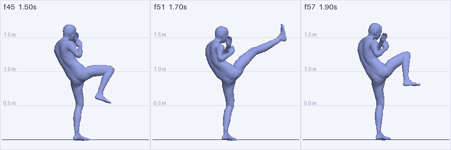
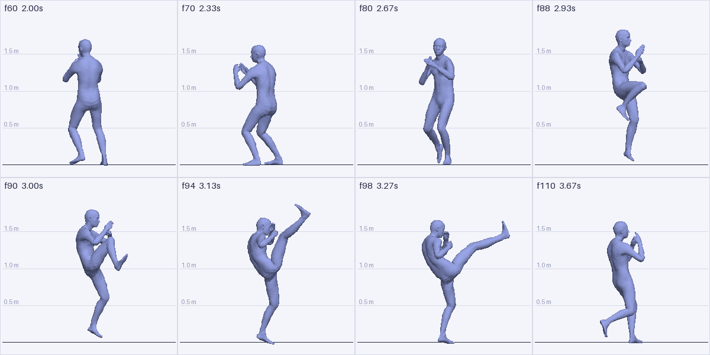
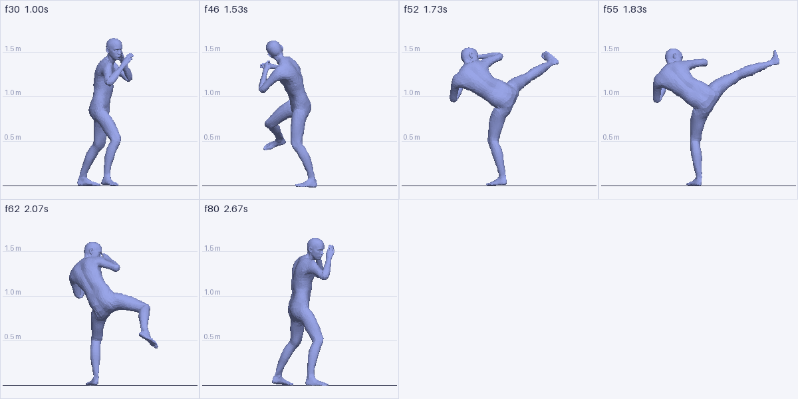
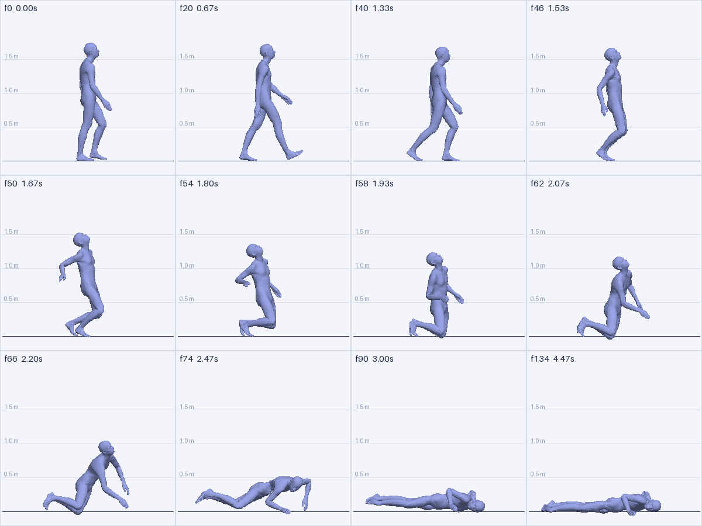
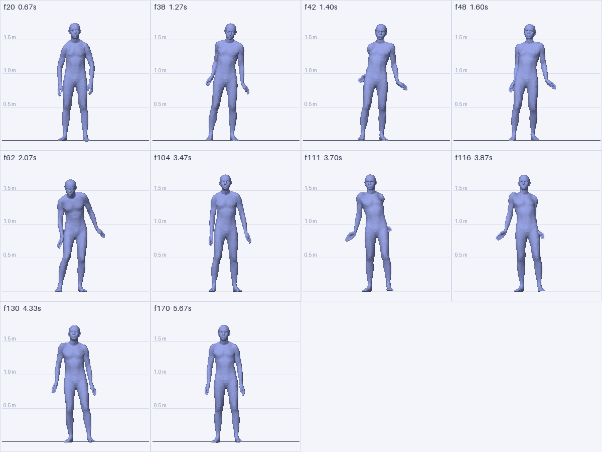
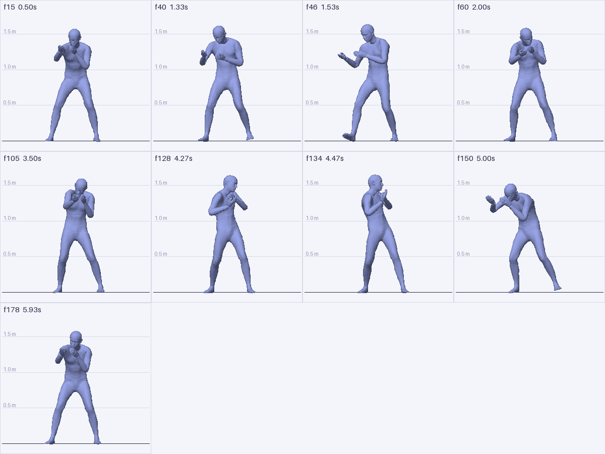
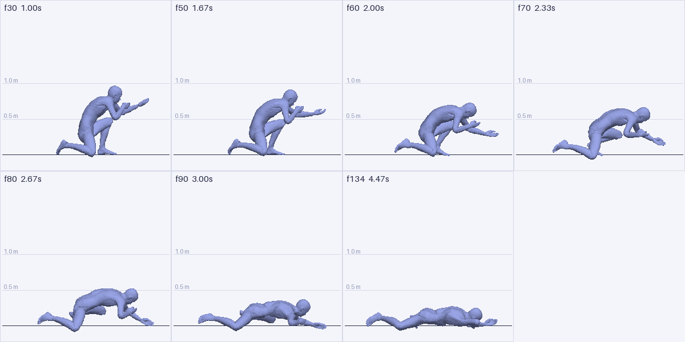
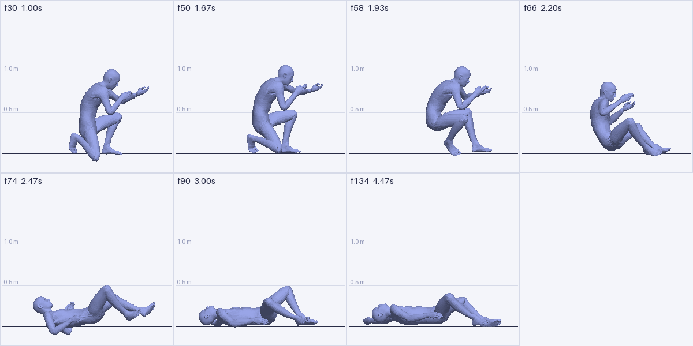
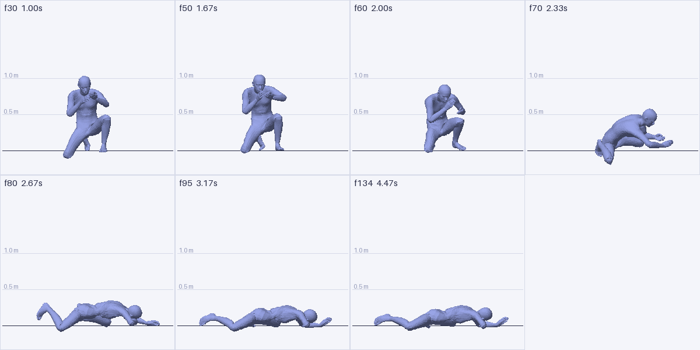
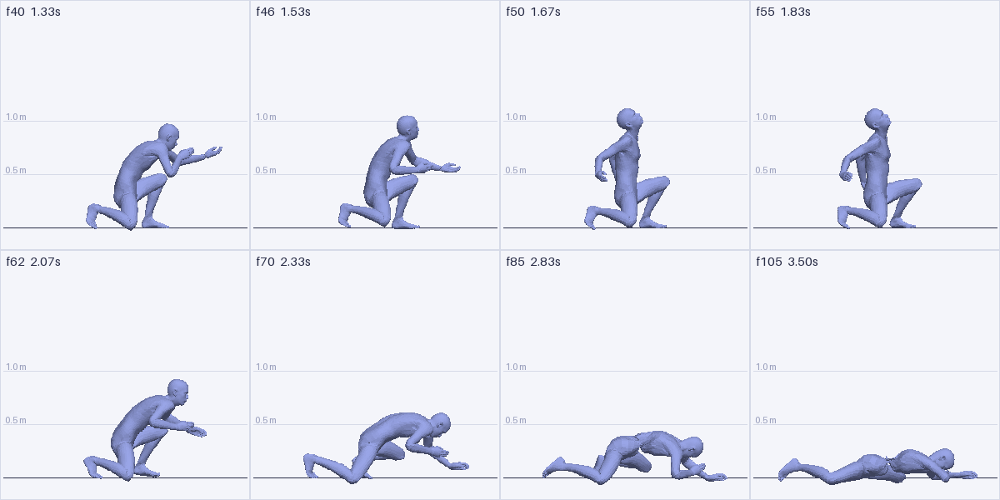

# Kimodo on Apple Silicon Mac

[](https://github.com/anasabdullahysfzai/kimodo-mac)
[](https://github.com/nv-tlabs/kimodo)
[](#requirements-check-these-first)


<sub>Teaser animation from the official [Kimodo repository](https://github.com/nv-tlabs/kimodo) by NVIDIA, used under the [Apache License 2.0](assets/LICENSE-kimodo). See [assets/NOTICE.md](assets/NOTICE.md).</sub>


> **How to use:** tell Claude Code (or another coding agent running natively on your Mac):
> *"Follow https://github.com/anasabdullahysfzai/kimodo-mac to install Kimodo on this Mac."*
> Or follow it by hand. Verified on 2026-11-03 on an M5 Pro MacBook Pro (48 GB), macOS 26, Python 3.11, torch 2.15. Kimodo's interactive web demo (`kimodo_demo`) works, and text prompts generate motion in the browser.
>
> This is an unofficial community guide, not affiliated with NVIDIA.

---

## Goal

Install NVIDIA Kimodo (https://github.com/nv-tlabs/kimodo), a text-to-3D-human-motion diffusion model, and run its interactive web demo at http://localhost:7860 on this Mac. The upstream repo targets Linux + NVIDIA CUDA. The steps below include every Mac-specific fix needed. Follow them in order, run commands natively on the Mac, and stop and report the first unexpected error before patching anything not listed here.

## Requirements (check these first)

1. **Apple Silicon Mac** (`uname -m` → `arm64`). **32 GB+ unified memory** recommended: the text encoder alone is a 16 GB Llama-3-8B in bf16. Only tested with 48 GB.
2. **~25 GB free disk**: about 16 GB for Llama-3-8B-Instruct, about 1.1 GB per Kimodo checkpoint, plus the Python env.
3. **Homebrew tools:** `uv` and `git` (`brew install uv`).
4. **Hugging Face account with access to `meta-llama/Meta-Llama-3-8B-Instruct`.** This is a gated model:
   - Request access at https://huggingface.co/meta-llama/Meta-Llama-3-8B-Instruct ("Expand to review and access", real name/details). Approval took a few hours.
   - Create a **Read** token at https://huggingface.co/settings/tokens and run `hf auth login`. Check with `hf auth whoami`.
   - Verify access (should print `200`, not `403`):
     ```bash
     curl -s -o /dev/null -w "%{http_code}\n" -I -H "Authorization: Bearer $(cat ~/.cache/huggingface/token)" https://huggingface.co/meta-llama/Meta-Llama-3-8B-Instruct/resolve/main/config.json
     ```
   - OpenRouter or any chat API **cannot** replace this: Kimodo reads Llama's internal hidden states through LLM2Vec, so the weights must run locally.

## Important for AI agents: sandboxed shells

Claude Code's Bash sandbox allows `huggingface.co` but **blocks Hugging Face's file CDN** (`us.aws.cdn.hf.co`, `cas-bridge.xethub.hf.co`, …). Large downloads stall (e.g. stuck at exactly 1,024,000,000 bytes) or fail with `No route to host`. Also, the two servers must keep running and talk to each other on localhost.

**So: run the big download (step 4) and both servers (step 6) in a real terminal**, either the user's own terminal or Claude Code's Terminal panel (`run_in_terminal`). Don't run them through the sandboxed Bash tool.

## Step 1: Clone and create the environment

```bash
mkdir -p ~/kimodo-local && cd ~/kimodo-local
git clone https://github.com/nv-tlabs/kimodo.git
cd kimodo
uv venv --python 3.11 .venv
source .venv/bin/activate
uv pip install torch
python -c "import torch; print(torch.__version__, torch.backends.mps.is_available())"   # expect: True
```

## Step 2: Install Kimodo WITHOUT the MotionCorrection C++ extension

The bundled `MotionCorrection` C++ extension is written with **x86 SSE/AVX intrinsics** (`immintrin.h`, `-msse4.1 -mavx`), so it cannot compile for arm64. It is only used by the optional "Post Processing" step, so skip it:

```bash
SKIP_MOTION_CORRECTION_IN_SETUP=1 uv pip install -e ".[all]"
python -c "import kimodo, viser; print('imports ok')"
```

(If you ever try building it anyway: an x86_64 `cmake`, e.g. from MacPorts at `/opt/local/bin/cmake`, silently produces x86_64 binaries that won't load in arm64 Python. Check with `file $(which cmake)`.)

## Step 3: Turn off post-processing by default

The demo enables Post Processing by default, which needs the extension skipped above and would raise an error on every generation. Turn the default off:

```bash
sed -i '' 's/^INIT_POSTPROCESSING = True/INIT_POSTPROCESSING = False  # macOS: motion_correction not built on arm64/' kimodo/demo/config.py
grep -n "INIT_POSTPROCESSING =" kimodo/demo/config.py
```

Users must keep the **Post Processing** checkbox off in the UI.

## Step 4: Download the models (real terminal, see the sandbox note)

```bash
source .venv/bin/activate
hf download meta-llama/Meta-Llama-3-8B-Instruct --exclude "original/*"   # ~16 GB; re-run to resume if it stops
hf download nvidia/Kimodo-SOMA-RP-v1.2                                    # demo default, ~1.1 GB (optional; auto-downloads on launch)
```

The LLM2Vec adapters (`McGill-NLP/LLM2Vec-Meta-Llama-3-8B-Instruct-mntp` and `…-mntp-supervised`, ~330 MB, public) download automatically on the first encoder start.

## Step 5: (Only if Llama access is still pending) use an ungated mirror

You can skip this if step 4 worked. While waiting for Meta's approval, the encoder can use the identical re-upload `NousResearch/Meta-Llama-3-8B-Instruct`. Meta's Llama 3 license still applies. Download the two adapter repos locally and repoint the base model:

```bash
cd ~/kimodo-local
for r in McGill-NLP/LLM2Vec-Meta-Llama-3-8B-Instruct-mntp McGill-NLP/LLM2Vec-Meta-Llama-3-8B-Instruct-mntp-supervised; do hf download $r --local-dir text_encoders/$r; done
sed -i '' 's#"meta-llama/Meta-Llama-3-8B-Instruct"#"NousResearch/Meta-Llama-3-8B-Instruct"#' text_encoders/McGill-NLP/LLM2Vec-Meta-Llama-3-8B-Instruct-mntp/adapter_config.json
hf download NousResearch/Meta-Llama-3-8B-Instruct --exclude "original/*"
```

Then add `TEXT_ENCODERS_DIR="$HOME/kimodo-local/text_encoders"` in front of **both** commands in step 6. The prompt formatting is unaffected because the adapter's `config.json` still names the Meta model.

## Step 6: Launch (two real terminals, encoder first)

**Terminal A: text encoder service** (runs Llama on the Mac GPU via MPS, port 9550):
```bash
cd ~/kimodo-local/kimodo && source .venv/bin/activate && PYTORCH_ENABLE_MPS_FALLBACK=1 TEXT_ENCODER_DEVICE=mps TEXT_ENCODER_TMP_FOLDER="$TMPDIR/text_encoder" kimodo_textencoder
```
Wait for `Running on local URL: http://0.0.0.0:9550` (first start takes a few minutes).

**Why `TEXT_ENCODER_TMP_FOLDER`:** the default `/tmp/text_encoder` resolves to `/private/tmp` on macOS. Gradio rejects it with `InvalidPathError: Cannot move /tmp/text_encoder/....npy to the gradio cache dir`. The demo then reports `Text encoder service is unreachable, falling back to local LLM2Vec encoder` and loads a second 16 GB copy of Llama on CPU. If you ever see that fallback message, stop the demo and fix the encoder first.

**Terminal B: demo** (port 7860):
```bash
cd ~/kimodo-local/kimodo && source .venv/bin/activate && PYTORCH_ENABLE_MPS_FALLBACK=1 kimodo_demo
```
Wait for `Model kimodo-soma-rp loaded successfully` (and **no** "unreachable" line), then open **http://localhost:7860**.

## Step 7: Verify

1. Close the welcome dialog. The default prompt box reads "A person walks forward." (6 s).
2. Click **Generate**. Terminal B shows a 100-step progress bar.
3. Scrub the timeline (e.g. frame 105). The character should be mid-stride, well forward of the start.

**Expected speed (M5 Pro):** ~60 s for a 6 s / 180-frame clip. The motion model runs on **CPU**, because the demo picks `cuda` if available, else `cpu`. The prompt encoding on MPS is fast.

## Harmless warnings (ignore)

- `torch.jit.script is deprecated`
- Encoder load report: `lm_head.weight | UNEXPECTED`, and a table of `lora_A/lora_B … UNEXPECTED / MISSING`. That's the pinned transformers/peft versions auto-loading the adapter with a key-prefix mismatch. Kimodo then loads it properly via PEFT, hence `Already found a peft_config attribute in the model`. Same on Linux. Output quality is fine.
- `The parameters have been moved from the Blocks constructor to the launch() method in Gradio 6.0`
- `To copy construct from a tensor, it is recommended to use sourceTensor.detach().clone()`

## Troubleshooting

| Symptom | Cause / fix |
|---|---|
| `403 … not in the authorized list` | Llama access not approved yet, or token not set. See requirements, or use step 5. |
| `Repository not found` on `meta-llama/...` | Same as above (gated repo, no access). |
| Download stuck at 1.0 GB / `No route to host` | Running inside a sandboxed agent shell. Run it in a real terminal. Plain re-run resumes. |
| `unknown type name 'FORCE_INLINE'`, `undeclared identifier 'labs'`, `unsupported option '-msse4.1'` | You're building MotionCorrection. Use `SKIP_MOTION_CORRECTION_IN_SETUP=1` (step 2). |
| `incompatible architecture (have 'x86_64', need 'arm64')` | x86 `cmake` built the extension. Skip the extension (step 2). |
| `motion_correction package is not installed` on Generate | Post Processing checkbox is on. Turn it off (step 3). |
| `Text encoder service is unreachable, falling back…` | Encoder not running, or the `/tmp` path issue. See step 6. |

## Prompts we tried

Results from our own runs in the demo (Kimodo-SOMA-RP-v1.2, default settings):

| Prompt | Result |
|---|---|
| A person walks forward. | Worked (default demo prompt) |
| A person kicks to the head of the other person | Did not produce a head kick. Kimodo generates one body only. |
| A person shifts their weight onto their left leg and kicks their right leg high in front of them at head height, then returns to a fighting stance. | Kick reached chest height |
| A person in a fighting stance kicks their right leg extremely high, lifting their foot above their head. | Kick reached head height |
| A person in a fighting stance spins around and swings their right leg in a wide arc above their head. | Spin worked, kick at hip height |
| A person in a fighting stance spins around quickly and kicks their right leg extremely high, lifting their foot above their head. | Kick at hip height |
| Separate prompt boxes: a spin, then the head-height kick prompt above | Kick still low |
| The head-height kick prompt as a 3 s take via the MCP server (seed 42) | Peak 0.87 m. The same prompt at 6 s reached head height. |

The Kimodo repo ships more example prompts, e.g. "A person is casually walking forward slowly" and "A person walks forward and picks something up from the ground". We haven't tested those here.

Settings in the demo's Model Parameters: Seed, Denoising Steps (default 100), Classifier-Free Guidance Text Weight and Constraint Weight (both default 2.0). Num Samples generates several takes at once. The timeline also supports constraints (Full-Body, 2D Root, hands, feet); we haven't tested them.

## Use with Claude (MCP)

`mcp/` is an MCP server that lets Claude Code generate Kimodo motions, look at them, measure them and refine them, without the web demo. It renders the SOMA body itself (numpy + PIL, no browser or OpenGL), so Claude can see each take as an image.



<sub>`render_motion` output for "A person in a fighting stance kicks their right leg extremely high, lifting their foot above their head." (6 s, seed 42), frames 45, 51 and 57. Guides every 0.5 m.</sub>

| Tool | What it does |
|---|---|
| `generate_motion` | Generates takes from one or more prompt segments (seconds each), with seed, diffusion steps, text/constraint weights, number of samples. Optional `keyframes_from` (lock full-body poses copied from earlier takes, several sources allowed, each with `at_frames` to move them in time, `offset_xz` to move them in space, `mirror` to swap left and right, `turn_deg` to rotate the pose by a fixed angle (works for lying poses too), `upper_body_from` to put another pose's spine, head and arms on these hips and legs, `face_heading_deg` to turn the whole pose so the hips face a direction, and `hips_heading_deg` to turn only the hips and legs, which converts a whole-body swivel into torso twist), `root_path` (x/z waypoints) or raw Kimodo `constraints`. |
| `render_motion` | Returns a contact-sheet image of chosen frames: side (faces right), front, three-quarter or top view. |
| `analyze_motion` | Returns numbers: peak height and frame of head, hands, ankles and toes (relative to the head, with body heading, torso lean, knee angle and lean direction vs. the foot at that frame), root travel and walking speed in the first second, heading every 0.5 s (from the line across the hips, so it stays valid lying down) and the frames where turning happens, max torso lean, an end pose (head and hips height, torso lean and its direction vs. the starting facing, forward travel, fall time, net movement in the last 0.5 s), lowest point, foot contact, jitter and the frames where it spikes. Multi-prompt takes also get per segment: torso twist (shoulders vs. hips), how far each shoulder moved back, and posture (hips height, hand height, how far the hands are in front of the hips and apart, how much they wander, torso lean, knee bend, feet apart). |
| `export_motion` | Writes BVH, Kimodo NPZ or an MP4 render. |
| `add_layer` | Adds curve-driven rotations to chosen joints of a finished take, with no model run. Works for any motion, and has `impact_front`, `impact_back`, `impact_left` and `impact_right` presets with a `strength` multiplier. |
| `regenerate_range` | Redoes only a frame range with Kimodo, optionally with a new prompt. Every other frame stays exactly as it was. |
| `fix_ground` | Raises the body smoothly wherever its mesh goes through the floor. |
| `trim_take` | Cuts a take to a frame range, e.g. to remove an idle tail. |
| `list_takes` | Lists saved takes with prompts, settings, what each was edited from, and a one-line summary. |

Each take is saved to `~/kimodo-local/motions/<take id>/` as `motion.npz`, `meta.json` and (if used) `constraints.json`, the same layout as the demo's example folders.

### Install

Needs the install from the steps above, and the text encoder service from step 6 (Terminal A) running. The demo itself doesn't need to run.

```bash
cd ~/kimodo-local && git clone https://github.com/anasabdullahysfzai/kimodo-mac.git
uv pip install --python ~/kimodo-local/kimodo/.venv/bin/python -e ~/kimodo-local/kimodo-mac/mcp
~/kimodo-local/kimodo/.venv/bin/python ~/kimodo-local/kimodo-mac/mcp/check.py ~/kimodo-local/kimodo   # prints "check passed"
claude mcp add kimodo -e TEXT_ENCODER_MODE=api -- ~/kimodo-local/kimodo/.venv/bin/kimodo-mcp
```

Start a new Claude Code session, then ask for a motion, for example: *"Generate a 6 second high kick with Kimodo, render the peak from the side, and check the foot reaches head height."*

`TEXT_ENCODER_MODE=api` makes the server reuse the running encoder service instead of loading a second copy of Llama. Optional env vars: `KIMODO_MCP_TAKES` (take folder), `KIMODO_MODEL` (default `kimodo-soma-rp`), `KIMODO_DEVICE` (default `cpu`; `mps` untested).

### Watch it live in the demo (optional)

A small patch makes the web demo follow the MCP server. Every new take loads into your open demo tab and starts playing, with its prompt on the timeline and locked keyframes shown on the tracks. When Claude renders frames, your view steps through those frames. Each step shows a notification with the take and its numbers.

```bash
cd ~/kimodo-local/kimodo && git apply ~/kimodo-local/kimodo-mac/mcp/kimodo.patch
```

Then restart `kimodo_demo`. It prints `[kimodo-mcp live] following .../motions/_live.json`. The patch adds 10 lines to `kimodo/demo/app.py` and `kimodo/demo/ui.py`: it registers each tab's built-in Load Example function and starts the watcher in `mcp/kimodo_mcp/demo_live.py`. It also fixes a Kimodo crash (next section). Set `KIMODO_LIVE=0` to turn it off, or `git checkout kimodo/demo/app.py kimodo/demo/ui.py` to remove it.

### Kimodo fix: locked poses in multi-prompt timelines

In a multi-prompt timeline Kimodo crops every constraint to each segment. If a segment ends up with no frames of a constraint, generation fails with `RuntimeError: cannot reshape tensor of 0 elements`, which also happens in the web demo. `mcp/kimodo.patch` adds one line to `kimodo/model/kimodo_model.py` that drops empty constraints per segment. With it, locked poses in later segments keep their shape (3.7 cm max joint error in our test), but not their world position (0.62 m off), because Kimodo re-anchors each segment where the previous one ended.

### What we measured (M5 Pro, CPU, 100 diffusion steps)

- Generation: 21.6 s for a 3 s take, 35 to 41 s for one 6 s take, 66 to 95 s for two or three 6 s samples at once. The first call also loads the model.
- Rendering 8 frames: about 3 s. MP4 of a 6 s take: about 29 s.
- The kick prompt above reached head height at 6 s (right ankle 1.495 m, head 1.506 m, toes 0.14 m above head in a keyframed re-take). At 3 s with the same seed it peaked at 0.87 m.
- `keyframes_from` with frame 51 and a new seed held that pose to within 0.07 m.

### Editing a finished take

Both tools write a new take and leave the source untouched.

**`add_layer`** adds rotation on top of a motion. Each layer names `joints` (a group: `spine`, `neck_head`, `upper_body`, `left_arm`, `right_arm`, `hips`, `left_leg`, `right_leg`, or joint names), `pitch_deg` (+ = back), `twist_deg` (+ = right shoulder back), `side_deg` (+ = toward the right), `start` and `end`, and a `curve`: `spring` (fast rise, damped settle), `ease`, `hold`, or `[[frame, weight], ...]`. Frames outside a layer don't change. It's rotation only, so layers on hips or legs move the feet; the result reports `max_foot_drift_m`.

Tested, each in under 2 seconds with zero foot drift:
- Impact on t093 (`impact_front`, strength 1.5): head thrown 0.40 m back at 5.0 m/s, up from 0 m and 1.06 m/s. Only frames 47-79 changed. The hands still rise somewhat with the torso.
- Tired slump on a walk (spine and neck, `hold`): same legs and stride, hunched torso.
- Head turn on a standing take (`neck_head`, `ease`): the rest of the body doesn't move.

**`regenerate_range`** locks all frames outside the range to guide the model, then splices the new frames in and blends `blend_frames` (default 6) at each inner edge. Outside frames are copied, so they match exactly. It generates the whole clip internally, so it takes as long as a full generation: 93 s for 3 samples of 5.5 s.

Tested on t116 f58-80, where the soldier wrongly re-aimed after the hit, with "A kneeling person goes limp, arms dropping to the sides, and slumps forward toward the ground.": frames outside the range matched exactly in 3 of 3 takes, and in the best (t132) the hands fell to 0.25 m instead of rising to 0.65 m. Seam jolts were 17-31 m/s^2, against the take's existing 60. The new section has to meet the old motion at its edge, so if the hands drift back near the end of the range, widen the range.

**`fix_ground`** finds the lowest mesh point per frame and lifts the whole body with a smooth ease in and out. Set `start` to skip planted poses, because the lift also raises the feet. **`trim_take`** keeps a frame range and updates the prompt timings.

Final kneeling deaths, using all of these on the takes above (shared t093 aim, 5 s each): front t151, back t152, headshot t153. Floor sink after the aim is 0 (was up to 15 cm), the back death no longer slams down or raises its hands, and the headshot snaps the head alone. Up to 3.5 cm of knee sink remains in the kneel, left alone to keep the planted foot down.

The demo's timeline shows prompts shorter than 2 s as 2 s, so its labels can run slightly long. The motion file isn't affected.

### Worked example: a spinning head-height kick



<sub>Take t010, side view, frames 60–110.</sub>

Text alone didn't produce this: in the demo, and in 3 MCP samples of "A person in a fighting stance spins around quickly and kicks their right leg extremely high, lifting their foot above their head." (6 s), two takes spun about 360° but kicked at 0.22 m and 0.64 m. Steps that got there, all through the MCP tools:

1. Generate a take that spins (t001: 370° max turn, frames 54–88) and a take that kicks high (t004: the non-spinning kick prompt, ankle 1.495 m at frame 51).
2. Lock only the kick pose (t004 frame 51) at frame 98 of a new take: the kick landed, but the take didn't spin (75° max turn).
3. Also lock spin poses from t001 at frames 60 and 75: it turned to 176° and then turned back (heading at frame 90: 63°).
4. Lock t001 frames 75 and 85 (302°) so continuing the turn is shorter than reversing, plus the kick pose at frame 98, shifted `offset_xz: [-0.06, 0.40]` to where the spin ends. Result (t010): 360° spin, right ankle 0.19 m and toes 0.30 m above the head. Locking more frames (chamber, peak, retract) produced jitter spikes of up to 38.9 m/s² on the locked frames; locking fewer brought the peak down to 28.
5. `constraint_weight: 1.0` (t012): 359° spin, toes 0.14 m above the head, mean jitter 4.84 vs 5.37.

<details><summary>The final call</summary>

```json
{"segments": [{"prompt": "A person in a fighting stance spins around quickly and kicks their right leg extremely high, lifting their foot above their head.", "seconds": 6}],
 "seed": 42, "num_samples": 2, "constraint_weight": 1.0,
 "keyframes_from": [{"take_id": "t001-a-person-in-a-fighting", "frames": [75, 85]},
                    {"take_id": "t004-a-person-in-a-fighting", "frames": [51], "at_frames": [98], "offset_xz": [-0.06, 0.40]}]}
```
</details>

### Worked example: matching a reference (spinning hook kick)

Reference: a 6-frame spinning hook kick sequence diagram found through image search (not reproduced here). Its checkable traits: the kick lands mid-spin with the back turned, the torso leans well forward and away from the kicking leg, the leg is near straight at head height, then re-chambers and returns to stance. The spinning kick above (t010) failed three of them: heading at the kick 410° (after the spin), torso lean 24°, knee 146°.

1. New prompt in the reference's terms (3 samples): "A person in a fighting stance performs a spinning hook kick: they turn their back, lean their upper body forward and down, and swing their straight right leg in a wide arc at head height, then return to a fighting stance." Best (t016): 357° spin, kick at -280° (mid-spin), torso 45° leaning away from the foot, but toe 0.10 m below head and knee 141°.
2. Locked t016's spin-entry and recovery poses (frames 42, 48, 66, 76), left the kick free, text weight 3.0 (3 samples): all kicked mid-spin above head height; t019 reached a 164° knee at frame 55 but had a 32 m/s² jitter spike before the kick.
3. Locked t016 frames 42, 66, 76 plus t019 frame 55, text weight 3.0, constraint weight 1.5, seed 7. Result (t020): 350° spin, kick at -262°, toe 0.10 m above head, torso lean 52° away from the foot, knee 159° at the peak, mean jitter 3.26 (worst spike 23.9).



<sub>Take t020, side view, frames 30, 46, 52, 55, 62, 80: stance, chamber while turning, kick with back turned (2 frames), re-chamber, stance.</sub>

### Worked example: game death, shot from behind

Targets (common game-animation practice, my criteria): walking first (over 0.8 m/s in the first second), little turning (under 45°), face-down at the end (head and hips under 0.3 m, torso over 60° from vertical, pointing within 45° of the starting facing), a fast fall (head from 1.2 m to 0.4 m in 1.2 s or less), and lying still (under 0.03 m net movement in the last 0.5 s). Two more checks came from looking at renders: a back arch at the hit, and feet staying low after landing.

1. One-sentence prompt, 4.5 s, 2 samples: "A person walking forward is shot in the back, stumbles forward and falls face down on the ground, then lies motionless." t024 had a clear back arch but started from standing and crawled down over about 2 s. t025 walked at 1.28 m/s and fell in 0.57 s, but didn't arch and its legs flipped up to 0.65 m after landing.
2. A two-segment version (walk 1.5 s, then the hit and fall) fell well but barely walked (0.23–0.37 m/s). A three-segment version (walk, collapse, lie still, 1.5 s each) never fell in any of 3 samples.
3. Locked t025's walk (frames 0, 20, 40) and final prone pose (105, 134), plus t024's arch (frame 37) moved to frame 46 with `offset_xz: [0.06, 1.73]`, 3 samples. Result (t030): passes all checks, back arch 9°, feet at most 0.30 m after landing, fall in 0.67 s, 0.014 m net movement at the end.

Two metric bugs found on the way and fixed: heading from the hips' forward axis reported 250–280° of turning for bodies lying face-down (the axis points at the floor), and summed per-frame speed reported about 0.05 m/s for bodies that moved 2–3 cm in a second (model noise).



<sub>Take t030, side view: walk, back arch at the hit (f46–54), knees, face-down fall, still.</sub>

### Worked example: hit in the right shoulder, then the left (multi-prompt)

Timeline: "A person stands still." (1 s), then a right-shoulder hit (2.5 s), then a left-shoulder hit (2.5 s), each prompt describing the shoulder jerking back and the upper body twisting toward it, then recovering. Targets (mine): each shoulder moves back at least 0.08 m in its own segment and more than the other shoulder, torso twist of at least 15° each way from the neutral stance, recovery, staying on the feet with little travel, and hips turning less than 30°.

1. Baseline, 3 samples, then 3 more with stronger right-hit wording: the left hit worked every time (left shoulder 0.16–0.22 m back, twist -11° to -25°), the right hit didn't (twist change under 12° in 5 of 6 takes).
2. Mirrored t036's left hit into the right segment (`mirror: true`, frames 108/113/120 at 38/43/50), and kept t036's own left hit. This crashed Kimodo; see the fix above. After the fix both hits landed, but the hips swivelled about 56° with each hit.
3. Added `face_heading_deg: 0` to both borrowed poses, which turns each pose so its hips face forward while keeping the torso twist. Hip turn dropped to 11–13°.
4. The right hit looked short of 15° only because the segment's first frame is already blended into the reaction (Kimodo's 5 transition frames). Measured from the neutral stance at frame 0, 2 of 3 takes pass every check. Best (t046): right shoulder 0.128 m back with +20° twist, left shoulder 0.152 m back with -21° twist, hip turn 10.8°, travel 0.25 m.



<sub>Take t046, front view (the character's right is on the left of the image): neutral, right-shoulder hit (f38–48), recovery, left-shoulder hit (f111–116), recovered.</sub>

**Soldier version.** Same two hits, but from a combat-ready rifle stance, keeping the weapon up and returning to ready. Extra targets (mine): in the ready stance, hands at 1.0–1.4 m and at least 0.25 m in front of the hips, knees bent under 170°, feet at least 0.3 m apart; hands above 0.95 m on average during both hits. t046 failed all of these (hands at 0.85 m, legs straight).

1. Soldier wording in all three prompts ("A soldier stands in a combat-ready stance, knees slightly bent, holding a rifle up at chest height with both hands." then "The soldier is shot in the right shoulder: ... but they keep holding the rifle and return to the ready stance." and the same for the left), 7 samples over two seeds: every take held the rifle stance (hands 1.16–1.37 m, 0.5–0.6 m forward, 0.21–0.38 m apart; knees 119–147°), the right hit was weak in most, and the whole body swivelled 42–78° with each hit. The stance is bladed, so neutral twist varied from -14° to +15° between takes.
2. Mirroring the left hit would put the rifle in the other hand, so instead used t057, which had both hits, but as swivels (hips at -44° and +69°). Locked its ready pose (f15, f75), its right-hit peak (f46) with `hips_heading_deg: -15`, and its left-hit peak (f134) with `face_heading_deg: 25`. Both hits became strong; swivel 57–82°, now during the unlocked recovery after the right hit (f60).
3. Also locked t057 f60 with `face_heading_deg: 0`, softened the right hit to `hips_heading_deg: -25`, and copied the f15 ready pose to f172 so it ends in the same stance. Result (t063): right shoulder 0.40 m back (+21° twist from neutral), left 0.29 m (-44°), both recovered, hands at 1.23–1.26 m throughout, hips turn 34°. The ready stance leans 29° forward, which misses my 25° cap; I'd treat that cap as too tight for a combat stance.



<sub>Take t063, front view: ready stance, right-shoulder hit (f40–46), ready again, left-shoulder hit (f128–150), ready.</sub>

### Worked example: kneeling soldier deaths (front, back, headshot)

Each is two prompt segments: "A soldier kneels on one knee, aiming a rifle at eye level." (1.5 s), then the death (3 s). Targets (mine): crouched (hips at most 0.75 m) with hands raised and in front of the hips, held steady (under 5 cm of wander); hands drop on the hit; head and hips under 0.3 m at the end, still, less than 1 m of travel; and the fall direction of each variant. In every take the kneeling aim held: hips 0.39–0.48 m, hands 0.67–0.78 m and 0.53–0.65 m in front, 1–3 cm of wander. The hands sit below eye level; a more explicit "rifle butt against the shoulder, cheek on the stock" prompt didn't raise them.

- **Front, collapses forward:** "A soldier kneeling on one knee aiming a rifle is shot in the chest, drops the rifle and collapses forward onto the ground, then lies still." Text alone worked: 2 of 3 passed. t093 falls within 7° of straight ahead and lies still (2.8 cm of end movement).
- **Back, falls backward:** "A soldier kneeling on one knee with a rifle is shot from behind and falls backward onto the ground, then lies still." Text alone fell forward in 3 of 3 (10–46°), as did 9 earlier takes worded "falls backward". A root path forcing the hips back didn't help either (still face-down). Without the soldier context, "A person crouching loses balance, falls over backward and lies flat on their back." fell backward in 3 of 3 (160–174°). Locking that take's (t082) mid-fall and lying poses into the soldier timeline passed in 3 of 3 (172–174°); t098 is the pick.
- **Headshot, slumps sideways:** "A soldier kneeling on one knee is shot in the head and slumps sideways to the ground." Text alone, and 6 plain "slumps / topples sideways" takes, all fell forward (6–29°). Turning t093's lying pose 90° with `turn_deg` and moving it beside the kneeling spot (`offset_xz: [0.38, -0.59]`) passed in 3 of 3 (84–85°, 0.35–0.38 m travel). t110 is the pick.





<sub>Takes t093 (side view), t098 (side view) and t110 (front view, the character's left is on the right of the image).</sub>

**Making the bullet impact noticeable.** In those 2-prompt takes the hit barely showed: t093's head never moved back and peaked at 1.06 m/s. A third, middle prompt of 1 s for the hit alone moved the head back only 5-10 cm. What worked was the middle prompt plus locked poses: the aim at f15 and f40, then the arch from the walking death t030 (f50) on the take's own kneeling legs via `upper_body_from` at f50 and f55, then the original slump and landing poses right after, so the soldier doesn't recover and re-aim in between (which it did until the slump was locked). Results: front t118 (head 0.38 m back, 2.5 m/s), back t122 (0.63 m, 3.9 m/s), headshot t125 (0.37 m, 3.1 m/s), all landing as before. Peak jitter is high by design on the impact frames (up to about 60 m/s2).



<sub>Take t118, side view: aim (f40), impact (f50-55), slump, face-down.</sub>

### Limits

- Post-processing is off (it needs the x86-only extension).
- Moving one joint to a target ("raise the foot 20 cm") isn't supported; it would need inverse kinematics. Lock poses with `keyframes_from` and re-roll instead.
- Renders are flat-shaded and only for SOMA-skeleton models.

## Not done / possible next steps

- Running the motion model on MPS (would need a small patch to `kimodo/demo/app.py`, which hard-codes `cuda:0` or `cpu`). Untested.
- Porting MotionCorrection to arm64 (e.g. via `sse2neon`). Untested.
- `kimodo-mlx` (https://github.com/NomaDamas/kimodo-mlx) is a CLI-only MLX port with an ungated text bundle, if you don't need the UI.
